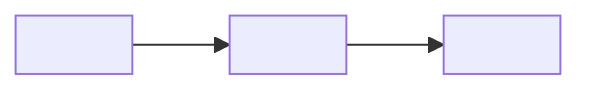

# <Subject>

What this page describes, who it is for, and how far down it goes. Name the page one level
up and the page one level down.

## Overview

The whole subject in one diagram and one paragraph.

## <Part>

One section per box in the diagram: what it is, what it owns, what it talks to. Structure
only — line-level walkthroughs rot, and belong in `workflows/`.

| <Element> | <Responsibility> |
| --- | --- |
| <name> | <what it owns> |

---

Related: [<page>](<path>) · [<page>](<path>)
