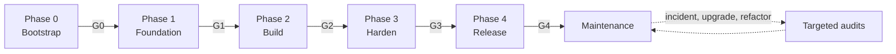

# Lifecycle Conventions

The path from the day these rules are installed — in a project with no code yet, or one long in
production — to a released product: five phases, each closed by a gate. A gate
is a list of checkable criteria with stable IDs; [`docs/audit/readiness.md`](../audit/readiness.md)
tracks them, and the [`phase-gate`](../../.ai/prompts/audits/phase-gate.md) audit verifies them.
Normative: a phase is not over because the calendar says so, only because its gate closed.

Behaviour is built spec-first throughout (see [`specs.md`](specs.md)): the gates ask whether the
specs exist, are implemented, and are proven — not merely whether code exists.

## Scope

Applies to:

- the project as a whole, from the first commit to the first release and through maintenance
- `AGENTS.md`'s **Phase** line, which always names the current phase

## Gates

- A gate closes when every criterion is ✅, or is waived by the project owner with the reason
  recorded on its row. An agent never waives a criterion.
- Closing a gate is a change of its own: the phase-gate audit is run and filed as a report, the
  readiness audit's rows are updated, and `AGENTS.md`'s **Phase** line advances.
- Criteria are cumulative. A criterion closed at G1 that regresses later reopens, and blocks every
  later gate until it closes again.
- Work belonging to a later phase does not start before the current gate closes unless the owner
  asks for it. Building features on an unfinished foundation is how the foundation stays unfinished.
- A criterion that names an audit is met only by a run of that audit that is fresh — no older than
  the last change to its scope.

## Adopting an existing project

Rules installed into a project that already has code go through
[`adopt.md`](../../.ai/prompts/adopt.md) instead of bootstrap. The gates and their criteria are the
same; what differs is how the project enters them.

- **Decisions are recorded, not made.** ADR-0001 and ADR-0002 record the stacks and the shape the
  code already has, as retroactive decisions. A decision the owner wants changed is a new ADR.
- **The phase is assessed, not assumed.** Baseline audits run at adoption — architecture
  conformance, modularity when modular, security, test coverage, dependencies, and spec
  conformance in register mode — and the phase-gate audit checks every gate against what exists.
  The owner sets the **Phase** line from its report. A criterion the project does not meet stays
  not met; nothing is waived by default.
- **Existing behaviour is registered.** Every capability found is a row of
  `docs/audit/legacy-capabilities.md`: not overreach, but not yet specified. It gets a spec before
  its behaviour changes ([`specs.md`](specs.md) → *Legacy behaviour*), and G2.1 counts the legacy
  capabilities in scope like any other.
- **Existing violations are baselined.** A check the existing code fails is switched on with a
  baseline that only shrinks ([`testing.md`](testing.md) → *Baselines*); baseline-audit findings land
  in the living audits like any others.

## Phase 0 — Bootstrap

The rules are in place and the decisions everything else rests on are written down. Nothing is
built yet — a project that already has code enters through adoption instead.

| ID | Criterion |
| --- | --- |
| G0.1 | The rules are installed; every `<!-- bootstrap: … -->` placeholder is filled or removed; the agents that work in the project are listed in `.ai/agents` and their rule files generated |
| G0.2 | ADR-0001 records each app's stack and major versions, with the alternatives considered; `AGENTS.md`'s **Stacks** table assigns each app its profiles, and unused profiles and their rule files are removed |
| G0.3 | ADR-0002 records the top-level shape — single app or monorepo, the apps and their surfaces — and, when modular, the modules and the modularity level |
| G0.4 | `docs/architecture/` has a context page: the people who use the product, every external system, and the capabilities in scope, one line each — each becomes a spec |
| G0.5 | `docs/reference/glossary.md` holds the domain's terms, one name per concept |
| G0.6 | Project hygiene: ignore files, `.editorconfig`, example environment files with no real values; under version control, no secret in history and the default branch protected |
| G0.7 | The local environment boots with one documented command, recorded under **Common Commands** in `AGENTS.md` |
| G0.8 | CI runs lint, format check, type check, test and build for every app, and `.ai/bin/check`, on every change, even while the suites are empty |
| G0.9 | Pull-request templates are in place and their checklists point at the conventions and the specs |

## Phase 1 — Foundation

The skeleton every feature hangs on: surfaces, identity, the enforcement of conventions, the paths to
production. The foundation's capabilities — sign-in, roles, tenancy — are specified like any other.

| ID | Criterion |
| --- | --- |
| G1.1 | Every app's surfaces are declared in the one place its profile names, and the surface table in [`architecture.md`](architecture.md) is filled |
| G1.2 | When modular: every module in ADR-0002 exists with its public surface, and the dependency graph is enforced by tooling |
| G1.3 | Arch tests enforce the mechanically checkable conventions listed in [`testing.md`](testing.md), and pass |
| G1.4 | Authentication and the authorization model are specified, Implemented, and deny by default |
| G1.5 | Structured logging and error tracking are wired; queues have named tiers; failed jobs land where a person sees them |
| G1.6 | Required configuration stops the start when missing; the lock store supports atomic locks |
| G1.7 | The test database is isolated and the suite refuses to run against a non-test database |
| G1.8 | The frontend shell exists: HTTP client, shared table, design-system base components, i18n, generated server types |
| G1.9 | A deploy pipeline reaches a staging environment and migrates the database it should, and only that one |
| G1.10 | Architecture-conformance, modularity (when modular), dependencies and operations audits have run; none has an open Critical or High |

## Phase 2 — Build

Every capability goes through the loop in [`specs.md`](specs.md) → *The workflow*:

1. **Specify** and **clarify** — `spec.md`, no markers left;
2. **approve** — the owner;
3. **design** — `design.md` where required, ADRs for new decisions;
4. **plan tasks** — `tasks.md`, tests before code;
5. **implement** — task by task, each acceptance test seen failing first;
6. **verify** — the spec-conformance audit scoped to the spec; status Implemented.

Every pull request names its spec and tasks and passes its template's checklist. The bugs,
consistency and documentation-drift audits run at each milestone the owner names, so debt is found
while the code is fresh.

| ID | Criterion |
| --- | --- |
| G2.1 | Every capability in scope has a spec at Implemented, or the owner moved it out of scope |
| G2.2 | Every requirement of every Implemented spec is traced to a passing test |
| G2.3 | Spec conformance: no open divergence or overreach finding of High severity |
| G2.4 | Every plan in `docs/plans/` reads Done, or the owner moved it out of scope |
| G2.5 | Every flow that moves money or changes a lifecycle state has a workflow document |
| G2.6 | Bugs, consistency, database-schema, frontend and test-coverage audits have run, and architecture conformance and modularity re-run; no Critical open; every open High has a fix planned for Phase 3 |

## Phase 3 — Harden

Nothing new; everything that exists made safe, fast, simple and true.

| ID | Criterion |
| --- | --- |
| G3.1 | Security audit: no open Critical or High |
| G3.2 | Bugs living audit: no open Critical or High |
| G3.3 | Performance audit: no open High; every money-path lookup is indexed; every quantified performance requirement in a spec is measured and met |
| G3.4 | Simplification, dead-code and complexity audits: each finding fixed or moved to a backlog with its reason |
| G3.5 | Naming and consistency audits: no open High; each Medium fixed or backlogged |
| G3.6 | Modularity (when modular): no cycle, no undeclared seam, no breach of the declared level |
| G3.7 | Documentation-drift audit: no open High |
| G3.8 | Frontend audit: no open High on accessibility, localisation or console errors |
| G3.9 | Operations re-run: backups configured and one restore performed; monitoring and alerting on errors, queues and schedulers; an incident runbook exists |

## Phase 4 — Release

The release commit is the audited commit.

| ID | Criterion |
| --- | --- |
| G4.1 | The phase-gate audit ran at the release commit, and every required audit is fresh |
| G4.2 | Zero open Critical or High across every living audit; each open Medium and Low is fixed or in a backlog the owner accepted |
| G4.3 | Every spec in the release is Implemented, and the release notes list them |
| G4.4 | Rollback is planned and tested: the deploy can be reverted, and every migration since the last release is reversible or has a written forward fix |
| G4.5 | Production configuration verified: debug off, secure cookies, secrets from the secret store, workers and schedulers running, failed-job sink present |
| G4.6 | The release is tagged; `AGENTS.md` reads **Phase 4 — Released**; architecture and reference documents match the release commit |

## Maintenance

After release, the cadence in [`auditing.md`](auditing.md) applies: a phase-gate audit before each
release, a spec for every behaviour change, and targeted audits after incidents, upgrades, ports and
cross-module refactors. A breaking change needs an ADR.

## Exceptions

- A project that skips a phase — a library with no deploy, a prototype never released — records
  the skipped criteria as waived on the readiness audit with the reason, rather than deleting them.
- A non-modular project marks the modularity criteria waived, citing ADR-0002.

---

Related: [`specs.md`](specs.md) · [`auditing.md`](auditing.md) · [`readiness.md`](../audit/readiness.md)
