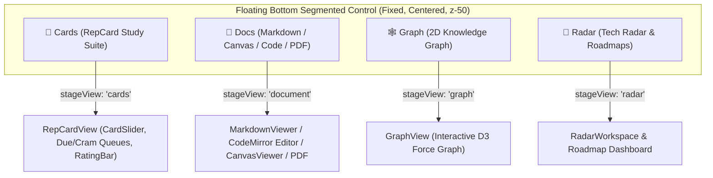
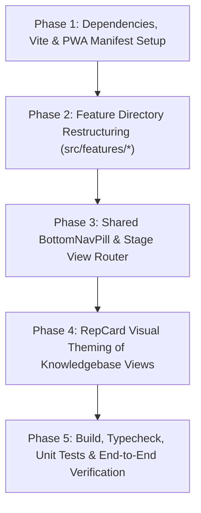

# RepCard & GenForge Knowledgebase Unified Migration Plan

## 1. Executive Summary & Design Vision

This document is the definitive blueprint for migrating and unifying the newly added **GenForge Knowledgebase** (`./obsidian`) into **RepCard** (`./src`) as a cohesive, offline-first personal knowledge and retention platform.

### Core Directives
1. **Model C Architecture (Bottom Segmented Pill)**:
   - Unified 4-stage interface: **`[ Cards | Docs | Graph | Radar ]`**.
   - Navigation is anchored by a persistent, tactile **floating bottom pill bar** styled in RepCard's high-contrast aesthetic.
2. **RepCard Design Supremacy**:
   - The knowledgebase components (markdown viewer, CodeMirror 6 editor, canvas viewer, graph view, radar workspace, top bar, and sidebar) adapt to **RepCard's visual design philosophy**:
     - Canvas Background: Pure Black (`#000000`)
     - Primary Accent & Surfaces: Vibrant Mint / Lime (`#a7ff83`)
     - Contrast Text & Key Depth: Deep Navy (`#071a52`) with tactile edges (`#75b35c` / `#041036`)
     - Typography: Google Sans (with Material Symbols Rounded & Lucide SVGs)
     - Zero blurry gradients or diffused shadows; tactile 3D card bevels, crisp solid borders, and sharp pill chips.
3. **Strict Feature Isolation (`src/features/`)**:
   - Complete domain isolation. RepCard is 100% self-contained in `src/features/repcard/`.
   - Knowledgebase modules are divided into `src/features/vault/`, `editor/`, `renderers/`, `graph/`, and `radar/`.
   - Cross-cutting storage and primitives live in `src/shared/`.
4. **RepCard Sovereign Brand & Functionality**:
   - PWA name, web manifest, metadata, icons, and theme colors remain **RepCard**.
   - Zero regression or modification to RepCard's study mechanics (FSRS v6, Due/Cram queues, swipe gestures, keyboard shortcuts, QR/hash sharing, and backups).
5. **Deck Boundary Isolation**:
   - Flashcard decks and library management live exclusively inside `src/features/repcard/`.
   - The knowledgebase sidebar displays the Vault file tree only.
6. **Deferred Scope**:
   - Vault note wikilink cross-references on cards and markdown flashcard extraction are deferred for future phases.

---

## 2. Navigation Architecture: Model C Bottom Floating Pill



### 2.1 Bottom Pill Visual & Interaction Specifications
- **Positioning**: Fixed at viewport bottom, centered horizontally:
  ```css
  position: fixed;
  bottom: max(1rem, env(safe-area-inset-bottom));
  left: 50%;
  transform: translateX(-50%);
  z-index: 50;
  ```
- **Appearance (RepCard Styling)**:
  - Container: Black canvas (`#000000`) with a solid 1.5px mint border (`border-[#a7ff83]/40`), pill shape (`rounded-full`), backdrop blur or solid black, crisp tactile shadow (`--pill-shadow`).
  - Active Item: Mint pill background (`#a7ff83`), deep navy text/icon (`#071a52`), tactile press-depth.
  - Inactive Item: Mint icon/text (`#a7ff83`), hover background (`rgba(167, 255, 131, 0.14)`).
- **Spatial Harmony in `Cards` View**:
  - In `cards` mode, RepCard's `RatingBar` (when enabled) and navigation controls are positioned cleanly above the bottom pill, or the bottom pill seamlessly integrates rating actions without visual overlap.
  - Generous tap targets (min 44px) optimized for mobile thumb reach.

---

## 3. Directory Layout: Feature-Isolated Architecture

```
repcard/
├── plans/
│   └── MIGRATION_PLAN_REPCARD_GENFORGE_KB.md # This blueprint
├── functions/                                # Cloudflare Pages Functions (GitHub OAuth)
│   └── api/auth/
│       ├── callback.ts
│       └── login.ts
├── public/                                   # PWA icons, manifest assets, static files
│   ├── icons/
│   └── theme-init.js
├── src/
│   ├── features/
│   │   ├── repcard/                          # Complete, self-contained RepCard Domain
│   │   │   ├── components/                   # CardSlider, FlashcardView, RatingBar, CardListView, FilterBar
│   │   │   ├── libraries/                    # LibraryDrawer, ShareLibraryModal, ScanLibraryModal, BackupModal
│   │   │   ├── hooks/                        # useLibraries, useCardProgress, useKeyboardShortcuts
│   │   │   ├── lib/                          # fsrs, storage, cardSort, starterDeck, qrScan, hashImport, colorModes
│   │   │   ├── types/                        # schema.ts (FlashcardItem, LibrarySource, Progress, etc.)
│   │   │   └── RepCardView.tsx               # Main RepCard view root
│   │   │
│   │   ├── vault/                            # Vault File Tree & Sync Domain
│   │   │   ├── components/                   # VaultTree, VaultSidebar, OnboardingModal, SettingsModal, ConflictModal
│   │   │   ├── providers/                    # githubProvider, localFsProvider
│   │   │   ├── lib/                          # vaultService, githubApi, githubPush, binaryStore, ignore, tree
│   │   │   └── types/                        # vault.ts, fsa.ts
│   │   │
│   │   ├── editor/                           # Markdown Editing Domain
│   │   │   ├── components/                   # MarkdownEditor (CodeMirror 6, Vim mode)
│   │   │   └── lib/                          # markdownPipeline, shikiHighlighter, checklist, frontmatter
│   │   │
│   │   ├── renderers/                        # Multi-format Document Renderers
│   │   │   └── components/                   # MarkdownViewer, CanvasViewer, CodeViewer, HighlightedCode, ImageViewer, PdfViewer
│   │   │
│   │   ├── graph/                            # Knowledge Graph Domain
│   │   │   ├── components/                   # GraphView (2D D3 force-directed)
│   │   │   └── lib/                          # graphBuilder
│   │   │
│   │   └── radar/                            # Tech Radar & Roadmaps Domain
│   │       ├── components/                   # RadarWorkspace, RadarChart, RadarCreator, RoadmapDashboard
│   │       ├── lib/                          # radarSchema, radarLayout, radarPresets
│   │       └── types/                        # radar.ts
│   │
│   ├── shared/                               # Cross-Cutting Shared Code
│   │   ├── components/                       # BottomNavPill, CommandPaletteModal, InstallBanner, SwUpdateToast, UI primitives
│   │   ├── db/                               # vaultDb.ts (Dexie IndexedDB)
│   │   ├── lib/                              # crypto, format, searchEngine, wikilinks, utils
│   │   └── store/                            # useAppStore.ts (Global state & stageView: 'cards' | 'document' | 'graph' | 'radar')
│   │
│   ├── App.tsx                               # Master AppShell with BottomNavPill & Stage Router
│   ├── main.tsx
│   └── index.css                             # RepCard Design System tokens & global styles
├── package.json                              # Consolidated dependencies
└── vite.config.ts                            # Consolidated Vite, PWA, Vitest & Icon subset plugins
```

---

## 4. Visual Design System: RepCard Theming Applied to Knowledgebase

```mermaid
graph LR
    subgraph RepCard Core Tokens
        Black["--bg-app: #000000"]
        Mint["--c-mint: #a7ff83"]
        Navy["--c-navy: #071a52"]
        EdgeMint["--c-mint-edge: #75b35c"]
        EdgeNavy["--c-navy-edge: #041036"]
    end

    subgraph Knowledgebase Application
        TopBarTheme["TopBar: #000000 surface, #a7ff83 accents, 1px mint borders"]
        SidebarTheme["Vault Sidebar: #000000 background, #a7ff83 active tree nodes"]
        EditorTheme["CodeMirror 6: RepCard One-Dark / Black Edition (#000000 base)"]
        CanvasTheme["Canvas Engine: Black canvas with Mint/Navy interactive cards"]
        GraphTheme["D3 Graph: Pure black void, Mint nodes, Deep Navy connecting lines"]
        RadarTheme["Tech Radar: Concentric Mint rings on Pure Black void"]
        PillTheme["Bottom Pill: Pure Black base, Mint border, solid Mint active tab"]
    end

    RepCard Core Tokens --> Knowledgebase Application
```

### Color Mode Persistence
The 3 RepCard color modes apply seamlessly across all 4 stages:
1. `default`: Black canvas (`#000000`), Mint surfaces (`#a7ff83`), Navy text (`#071a52`).
2. `navy-canvas`: Navy canvas (`#071a52`), Mint surfaces (`#a7ff83`), Navy text (`#071a52`).
3. `black-navy-card`: Black canvas (`#000000`), Navy surfaces (`#071a52`), Mint text (`#a7ff83`).

---

## 5. RepCard Feature Parity & Safety Matrix

| Feature | Scope / Behavior in Unified App | Verified Protection |
| :--- | :--- | :--- |
| **FSRS Study Engine** | `ts-fsrs` v6 calculations, Due queue calculation against session time, Cram queue with All/High/Low/Bookmarked/Hardest filters. | 100% Unchanged |
| **Touch Gestures** | Fluid touch swipe up (Good), down (Again), left (Next), right (Prev) in `CardSlider.tsx`. | 100% Unchanged |
| **Keyboard Shortcuts** | Space (flip), 1-4 (grade), Arrows, Z (undo), B (bookmark). Gated to fire **only** when `stageView === 'cards'` and focus is outside text inputs. | 100% Unchanged |
| **Deck Libraries** | Local starter deck, remote GAS/JSON sync with `?refresh=1`, enable/disable toggling. | 100% Unchanged |
| **Sharing & Scanning** | `uqr` SVG QR code generation and `jsqr` live camera QR scanning. | 100% Unchanged |
| **Backups** | Full JSON export and restore via `BackupModal.tsx`. | 100% Unchanged |
| **User Data Persistence** | Existing `localStorage` keys (`repcard_*`) preserved. No data wiped or altered. | 100% Unchanged |

---

## 6. Detailed Step-by-Step Implementation Roadmap



### Phase 1: Dependencies, Vite & PWA Alignment
- Merge dependencies from `obsidian/package.json` into root `package.json` (`@codemirror/*`, `d3-force`, `dexie`, `dompurify`, `lucide-react`, `mermaid`, `minisearch`, `pdfjs-dist`, `shiki`, `unified`, `remark-*`, `rehype-*`, `yaml`, `zustand`, `vitest`).
- Retain root dependencies: `@radix-ui/react-dialog`, `jsqr`, `uqr`, `zod`, `ts-fsrs`.
- Configure `vite.config.ts`:
  - Preserve `materialSymbolsSubset()` plugin.
  - Set PWA name = `RepCard`, short_name = `RepCard`, theme_color = `#000000`.
  - Include code-splitting and caching rules for heavy renderers (PDF.js, Shiki, Canvas).
- Run `pnpm install` and verify root lockfile.

### Phase 2: Feature Directory Restructuring
- Create directory hierarchy:
  - `src/features/repcard/`
  - `src/features/vault/`
  - `src/features/editor/`
  - `src/features/renderers/`
  - `src/features/graph/`
  - `src/features/radar/`
  - `src/shared/`
- Migrate RepCard components, hooks, lib, and types into `src/features/repcard/`.
- Migrate Obsidian components and modules into their respective `src/features/` folders.
- Relocate `obsidian/functions/` to root `functions/` (Cloudflare Pages GitHub OAuth).
- Relocate `obsidian/tests/` to root `tests/`.
- Safely remove the temporary `obsidian/` directory once transplant is validated.

### Phase 3: Shared BottomNavPill & Stage View Router
- Create `src/shared/components/BottomNavPill.tsx`:
  - 4 stages: `cards`, `document`, `graph`, `radar`.
  - Fixed bottom centered positioning with safe-area padding.
  - RepCard tactile styling (Black canvas, Mint border, solid Mint active indicator).
- Update `src/shared/store/useAppStore.ts`:
  ```typescript
  export type StageView = 'cards' | 'document' | 'graph' | 'radar';
  ```
- Update `src/App.tsx` to render:
  - Header & Stage content based on `stageView`.
  - When `stageView === 'cards'`: Renders `RepCardView` (AppHeader, CardSlider, RatingBar, CardListView, LibraryDrawer).
  - When `stageView !== 'cards'`: Renders TopBar, Sidebar, and Knowledgebase stages (Document, Graph, Radar).
  - Persistent `BottomNavPill` at bottom across all stages.

### Phase 4: RepCard Visual Theming of Knowledgebase Views
- Update `src/index.css` to define the unified RepCard design tokens across all components.
- Theme `TopBar.tsx`, `Sidebar.tsx`, `VaultTree.tsx`, `CommandPaletteModal.tsx`, and `OnboardingModal.tsx` in `#000000` black and `#a7ff83` mint.
- Update CodeMirror editor theme to match RepCard's black background and high-contrast accents.
- Update `CanvasViewer.tsx` and `GraphView.tsx` background, node, and link colors to match mint/navy palette.

### Phase 5: Verification & Regression Testing
- Verify RepCard:
  - Card flip, gesture swipe up/down/left/right.
  - Due mode review & Cram mode with all filter criteria.
  - FSRS rating intervals and 1-step undo.
  - Remote GAS/JSON library sync with `?refresh=1`.
  - QR code export & camera scanner import.
  - Backup export and import.
  - Color mode toggling (Default, Navy Canvas, Black-Navy Card).
- Verify Knowledgebase:
  - Local folder and GitHub repository sync.
  - Markdown note editing with Vim mode and Shiki syntax highlighting.
  - JSON Canvas pan/zoom and checklist toggles.
  - D3 2D Graph View navigation.
  - Tech Radar interactive filtering and roadmap progress.
- Run `pnpm build`, `pnpm typecheck`, and `pnpm test` to confirm clean builds and passing test suites.
