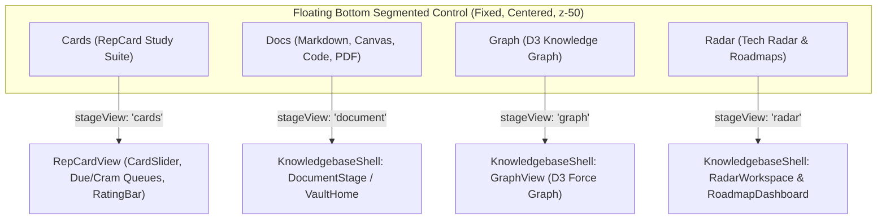
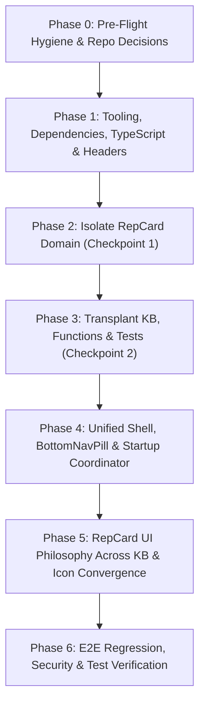

# RepCard & GenForge Knowledgebase Unified Migration Plan

**Status:** Pre-Implementation Blueprint | **Target Architecture:** Unified Offline-First PWA (`RepCard` + `./obsidian`)

---

## 1. Executive Summary & Core Directives

This document is the architectural and engineering blueprint for migrating **GenForge Knowledgebase** (`./obsidian`) into **RepCard** (`./src`) to create one cohesive, offline-first personal knowledge and spaced-repetition PWA deployed on Cloudflare Pages.

### Core Directives

1. **Model C Navigation (`BottomNavPill`):**
   - Unified 4-stage interface: **`[ Cards | Docs | Graph | Radar ]`**.
   - Navigation is anchored by a persistent, borderless floating bottom capsule styled in RepCard's visual language.
2. **RepCard UI Philosophy Mimicked Across Both Apps:**
   - Every Knowledgebase view (`TopBar`, `Sidebar`, `VaultTree`, `RightInspector`, `VaultHome`, `DocumentStage`, `MarkdownEditor`, `CanvasViewer`, `GraphView`, `RadarWorkspace`, and all modals/toasts) adopts **RepCard's exact design grammar**:
     - **Strict 3-Token Palette:** Pure Black (`#000000`), Deep Navy (`#071a52`), and Mint Lime (`#a7ff83`), plus tactile key-edge shades (`#75b35c` / `#041036`).
     - **Zero Gradients & Zero Structural Borders:** No `bg-gradient-*`, no `linear-gradient()`, and no hairline structural borders or dividers across chrome or cards. Depth and hierarchy come from solid contrasting surface blocks, elevation shadows (`--card-shadow`, `--pill-shadow`, `--header-shadow`), generous spacing, rounded containers (`rounded-2xl` / `rounded-3xl`), and `.key-depth` 3D tactile press buttons.
     - **Scoped `.liquid-glass` HUD:** Smoked translucent glass (`rgba(28, 28, 32, 0.32)` + `backdrop-filter: blur(24px) saturate(180%)`) is reserved exclusively for floating HUD overlays (`CardSlider` drag guides and the floating `BottomNavPill`).
     - **Decluttered Canvas-First Chrome:** Follow RepCard's quiet-viewport ethos — bold clean headers, minimal icon actions, and secondary tools tucked inside slide-over drawers or inspectors rather than multi-row toolbars.
     - **Single Typeface & Unified Iconography:** **Google Sans** (`400..700`, `font-bold` ceiling `<= 700`, Open Sans fallback) for all UI and prose, reserving monospace strictly for code blocks and CodeMirror. All UI icons converge onto build-time subsetted **Material Symbols Rounded** (`materialSymbolsSubset()` in `vite.config.ts`) so RepCard and Knowledgebase share one icon pipeline and remove `lucide-react` by Phase 5.
     - **Unified 3 Color Modes:** `default` (Black canvas / Mint card / Navy ink), `navy-canvas` (Navy canvas / Mint card / Navy ink), and `black-navy-card` (Black canvas / Navy card / Mint ink) drive all 4 stages from one persisted key (`srs:color_mode:v1`).
3. **Strict Feature Isolation (`src/features/*`) & Lazy KB Boundary:**
   - RepCard lives 100% self-contained inside `src/features/repcard/` and stays in the lean initial bundle for instant frame-1 study boot.
   - The Knowledgebase shell (`vault`, `editor`, `renderers`, `graph`, `radar`, Dexie, CodeMirror, PDF.js, Shiki, Mermaid) loads lazily behind `React.lazy()` on demand when entering `Docs`, `Graph`, `Radar`, or handling an OAuth callback.
4. **RepCard Sovereign Brand & Zero Regressions:**
   - PWA name, web manifest, icons, update/install prompts (`SwUpdateToast`, `InstallBanner`, `OnboardingModal`), and theme colors remain **RepCard**.
   - Zero regression to RepCard's study mechanics: FSRS v6 intervals, Due/Cram queues, 2-axis gesture physics, keyboard shortcuts, QR share/scan, JSON backup/restore, and `srs:*` `localStorage` persistence.
5. **Deck Boundary Isolation & Deferred Scope:**
   - Flashcard decks and library endpoints live exclusively in `src/features/repcard/`; the Vault sidebar displays Vault files only.
   - Cross-referencing vault wikilinks on flashcards and extracting flashcards from Markdown notes remain deferred to future milestones.

---

## 2. Navigation Architecture, Mobile Ergonomics & Collision Resolutions



### 2.1 `BottomNavPill` Visual & Interaction Specifications
- **Positioning:** Fixed horizontally centered above the bottom safe area (`z-50`):
  ```css
  position: fixed;
  bottom: max(1rem, env(safe-area-inset-bottom));
  left: 50%;
  transform: translateX(-50%);
  z-index: 50;
  ```
- **Borderless RepCard Styling:**
  - **Container:** Rounded capsule (`rounded-full p-1.5`) rendered in solid `--bg-app` or smoked `.liquid-glass` elevated strictly by `--pill-shadow` — zero hairline border rings.
  - **Active Tab:** Solid `--bg-card` pill with `--fg-card` icon/label, `font-bold`, and subtle `.key-depth` tactile press feel.
  - **Inactive Tabs:** `--fg-app` at `opacity-75` rising to `opacity-100` on hover, minimum `44px` tap target height for effortless mobile thumb reach.

### 2.2 Resolved Mobile & Layout Collisions

| Collision Identified in Codebase | Root Cause | Planned Fix |
| :--- | :--- | :--- |
| **Dual Mobile Bottom Bars** | `obsidian/src/components/MobileBottomNav.tsx` renders a fixed 5-tab footer (`Home`, `Files`, `Search`, `Sync`, `Settings`) below `lg` width, stacking directly on top of `BottomNavPill`. | **Retire `MobileBottomNav.tsx` completely.** Keep Vault Explorer, `Cmd+K` search, Sync, and Settings triggers cleanly accessible inside the decluttered `TopBar` and slide-over drawers so `BottomNavPill` is the sole bottom control across all viewports. |
| **`BottomNavPill` vs. `CardSlider` Down Guide** | `CardSlider.tsx` pins the floating Down swipe arrow at `bottom-[max(1rem,env(safe-area-inset-bottom))] left-1/2 -translate-x-1/2` — the exact screen coordinates of `BottomNavPill`. | Add `onDragActiveChange(active: boolean)` to `CardSlider`: while a finger/pointer drag is active, `BottomNavPill` transitions to `opacity-0 pointer-events-none` (matching reduced-motion rules) and the Down arrow cleanly clears the bottom edge. |
| **Stage Overlap Behind Floating Pill & Toast** | `RatingBar`, `CardListView`, `MarkdownViewer`, `RadarWorkspace`, and `SwUpdateToast` extend to the bottom viewport edge. | Reserve `pb-24` bottom clearance in `RepCardView` (positioning `RatingBar` cleanly above the pill), `CardListView`, `MarkdownViewer`, `VaultHome`, and `RadarWorkspace`; anchor `SwUpdateToast` at `bottom-20` above `BottomNavPill`. |
| **Viewport Scroll Model Mismatch** | RepCard uses `min-h-dvh` + window scroll (`window.scrollTo(0, 0)` in `App.tsx`), while Obsidian locks `html, body, #root { height: 100% }` with `h-dvh overflow-hidden` and inner flex scroll panes (`CanvasViewer`, `GraphView`, `MarkdownEditor`). | Standardize the unified root shell on `h-dvh w-full overflow-hidden flex flex-col` and convert `CardListView` to an internal `flex-1 min-h-0 overflow-y-auto` scroll container with a container ref for scroll-to-top resets. |

---

## 3. Complete Feature-Isolated Directory Layout

Every existing file across `./src`, `./obsidian`, and `./public` is mapped explicitly below — omitting `MobileBottomNav.tsx` (retired), decomposing `StagePlaceholder.tsx` (1,172 lines) into `VaultHome.tsx` + `DocumentStage.tsx`, and tracking all 17 Obsidian test suites + `setup.ts`.

```text
repcard/
├── .gitignore                                # Includes *.tsbuildinfo (drops committed obsidian/*.tsbuildinfo)
├── index.html                                # RepCard title, Google Sans + Material Symbols <link>, /theme-init.js
├── package.json                              # Merged deps + scripts: dev, build, lint, typecheck, test, preview
├── tsconfig.json                             # Composite references -> tsconfig.app.json, tsconfig.node.json, functions/tsconfig.json
├── tsconfig.app.json
├── tsconfig.node.json
├── vite.config.ts                            # vitest/config + materialSymbolsSubset() + VitePWA + manual chunks
├── plans/
│   └── MIGRATION_PLAN_REPCARD_GENFORGE_KB.md # This blueprint
├── docs/
│   └── plans/
│       └── flashcard_pwa_agent_plan.md
├── functions/                                # Relocated from obsidian/functions/ (Cloudflare Pages Functions)
│   ├── tsconfig.json
│   ├── env.d.ts
│   └── api/auth/
│       ├── callback.ts
│       └── login.ts
├── public/
│   ├── _headers                              # Merged CSP, camera=(self), sw.js & manifest rules
│   ├── _redirects                            # SPA fallback: /* /index.html 200
│   ├── theme-init.js                         # Rewritten to read srs:color_mode:v1 before first paint
│   ├── favicon.svg
│   ├── apple-touch-icon.png
│   ├── pwa-192x192.png
│   └── pwa-512x512.png
├── tests/                                    # Relocated from obsidian/tests/ (17 KB test files + setup.ts + RepCard/router tests)
│   ├── setup.ts
│   ├── AppShell.test.tsx
│   ├── binaryStore.test.ts
│   ├── canvasLayout.test.ts
│   ├── checklist.test.ts
│   ├── crypto.test.ts
│   ├── frontmatter.test.ts
│   ├── githubPush.test.ts
│   ├── githubSync.test.ts
│   ├── ignore.test.ts
│   ├── localFsProvider.test.ts
│   ├── markdownPipeline.test.ts
│   ├── merge3way.test.ts
│   ├── radarLayout.test.ts
│   ├── radarSchema.test.ts
│   ├── searchAndGraph.test.ts
│   ├── tree.test.ts
│   ├── wikilinks.test.ts
│   └── repcard/                              # Added in Phase 6: fsrs, storage, hashImport, startup routing, shortcuts
└── src/
    ├── App.tsx                               # Root stage router + useStartupCoordinator + lazy KnowledgebaseShell + BottomNavPill
    ├── main.tsx
    ├── index.css                             # Single RepCard token & style system driving all 4 stages
    ├── vite-env.d.ts
    ├── features/
    │   ├── repcard/                          # Self-contained RepCard Domain (kept in initial entry chunk)
    │   │   ├── RepCardView.tsx
    │   │   ├── components/
    │   │   │   ├── AppHeader.tsx
    │   │   │   ├── CardListView.tsx
    │   │   │   ├── CardSlider.tsx
    │   │   │   ├── FilterBar.tsx
    │   │   │   ├── FlashcardView.tsx
    │   │   │   └── RatingBar.tsx
    │   │   ├── libraries/
    │   │   │   ├── BackupModal.tsx
    │   │   │   ├── LibraryDrawer.tsx
    │   │   │   ├── ScanLibraryModal.tsx
    │   │   │   └── ShareLibraryModal.tsx
    │   │   ├── hooks/
    │   │   │   ├── useCardProgress.ts
    │   │   │   ├── useKeyboardShortcuts.ts
    │   │   │   └── useLibraries.ts
    │   │   ├── lib/
    │   │   │   ├── cardSort.ts
    │   │   │   ├── colorModes.ts
    │   │   │   ├── fsrs.ts
    │   │   │   ├── hashImport.ts
    │   │   │   ├── qrScan.ts
    │   │   │   ├── starterDeck.ts
    │   │   │   └── storage.ts
    │   │   ├── types/
    │   │   │   └── schema.ts
    │   │   └── ui/
    │   │       └── QrCodeImage.tsx
    │   │
    │   ├── vault/                            # Vault Sync, Explorer & Workspace Shell (lazy-loaded)
    │   │   ├── KnowledgebaseShell.tsx        # Replaces AppShell; lazy root for Docs / Graph / Radar
    │   │   ├── components/
    │   │   │   ├── ConflictModal.tsx
    │   │   │   ├── DocumentStage.tsx         # Extracted from StagePlaceholder.tsx
    │   │   │   ├── OnboardingModal.tsx
    │   │   │   ├── RightInspector.tsx
    │   │   │   ├── SettingsModal.tsx
    │   │   │   ├── Sidebar.tsx
    │   │   │   ├── TopBar.tsx
    │   │   │   ├── VaultHome.tsx             # Extracted from StagePlaceholder.tsx
    │   │   │   └── VaultTree.tsx
    │   │   ├── providers/
    │   │   │   ├── githubProvider.ts
    │   │   │   └── localFsProvider.ts
    │   │   ├── lib/
    │   │   │   ├── binaryStore.ts
    │   │   │   ├── documentIndex.ts
    │   │   │   ├── githubApi.ts
    │   │   │   ├── githubPush.ts
    │   │   │   ├── ignore.ts
    │   │   │   ├── merge3way.ts
    │   │   │   ├── sampleVault.ts
    │   │   │   ├── tree.ts
    │   │   │   └── vaultService.ts
    │   │   └── types/
    │   │       ├── fsa.ts
    │   │       └── vault.ts
    │   │
    │   ├── editor/                           # Markdown Editing Domain
    │   │   ├── components/
    │   │   │   └── MarkdownEditor.tsx
    │   │   └── lib/
    │   │       ├── checklist.ts
    │   │       ├── frontmatter.ts
    │   │       ├── markdownPipeline.ts
    │   │       └── shikiHighlighter.ts
    │   │
    │   ├── renderers/                        # Multi-Format Document Renderers
    │   │   ├── components/
    │   │   │   ├── CanvasViewer.tsx
    │   │   │   ├── CodeViewer.tsx
    │   │   │   ├── HighlightedCode.tsx
    │   │   │   ├── ImageViewer.tsx
    │   │   │   ├── MarkdownViewer.tsx
    │   │   │   ├── MermaidViewport.tsx
    │   │   │   └── PdfViewer.tsx
    │   │   └── lib/
    │   │       └── canvasLayout.ts
    │   │
    │   ├── graph/                            # Knowledge Graph Domain
    │   │   ├── components/
    │   │   │   └── GraphView.tsx
    │   │   └── lib/
    │   │       └── graphBuilder.ts
    │   │
    │   └── radar/                            # Tech Radar & Roadmaps Domain
    │       ├── components/
    │       │   ├── RadarChart.tsx
    │       │   ├── RadarCreator.tsx
    │       │   ├── RadarWorkspace.tsx
    │       │   └── RoadmapDashboard.tsx
    │       ├── lib/
    │       │   ├── radarLayout.ts
    │       │   ├── radarPresets.ts
    │       │   └── radarSchema.ts
    │       └── types/
    │           └── radar.ts
    │
    └── shared/                               # Cross-Cutting Shared Code
        ├── components/
        │   ├── BottomNavPill.tsx
        │   ├── CommandPaletteModal.tsx
        │   ├── InstallBanner.tsx
        │   └── SwUpdateToast.tsx
        ├── db/
        │   └── vaultDb.ts
        ├── hooks/
        │   ├── usePwaUpdate.ts
        │   └── useStartupCoordinator.ts
        ├── lib/
        │   ├── crypto.ts
        │   ├── format.ts
        │   ├── pwa.ts
        │   ├── scroll.ts
        │   ├── searchEngine.ts
        │   ├── theme.ts
        │   ├── utils.ts
        │   └── wikilinks.ts
        ├── store/
        │   └── useAppStore.ts
        └── ui/
            └── MaterialIcons.tsx             # Single subsetted icon registry for all 4 stages
```

---

## 4. RepCard Visual Design System Mimicked Across Knowledgebase

```mermaid
graph LR
    subgraph Tokens["RepCard Core Design Tokens"]
        Black["--c-black: #000000"]
        Navy["--c-navy: #071a52"]
        Mint["--c-mint: #a7ff83"]
        Edges["--c-mint-edge / --c-navy-edge"]
        Shadows["--card-shadow / --pill-shadow / --header-shadow"]
        Glass[".liquid-glass (HUD Overlays Only)"]
    end

    subgraph Surfaces["Knowledgebase Surfaces (Zero Hairline Borders, Zero Gradients)"]
        TopBarTheme["TopBar: --bg-app surface, --header-shadow, 3-mode cycler"]
        DrawerTheme["Sidebar & Inspector: Solid rounded panels, inverted active tree pills"]
        ProseTheme["Markdown & CodeMirror: Elevated #071a52/#000000 panes, #a7ff83 accents, calm white ink"]
        CanvasTheme["CanvasViewer: Borderless shadow-elevated cards mimicking FlashcardView"]
        GraphTheme["GraphView: Pure --bg-app void, #a7ff83 primary nodes, #071a52 links"]
        RadarTheme["RadarWorkspace: #a7ff83 concentric rings, borderless filter chips, .key-depth actions"]
        PillTheme["BottomNavPill: Borderless capsule, --pill-shadow, solid --bg-card active tab"]
    end

    Tokens --> Surfaces
```



### 4.1 Single Theme Engine (Eliminating Dual-Theme Conflicts)

RepCard (`srs:color_mode:v1` via `data-color-mode`) and Obsidian (`genforge-kb-ui-v1` via `dark | light | system` and `#0B132B` / `#F3F6FC`) previously ran separate theme pipelines that would fight over `<html>` attributes and `<meta name="theme-color">` on boot. The unified app collapses them into **one RepCard-owned theme system**:

1. **Three Cycleable Modes (`srs:color_mode:v1`):**
   - `default` — **Lime Hero (Black):** `#000000` canvas (`--bg-app`), `#a7ff83` card (`--bg-card`), `#071a52` card ink (`--fg-card`), `#a7ff83` app ink (`--fg-app`).
   - `navy-canvas` — **Lime Hero (Navy):** `#071a52` canvas, `#a7ff83` card, `#071a52` card ink.
   - `black-navy-card` — **Navy Hero (Black):** `#000000` canvas, `#071a52` card, `#a7ff83` card ink.
2. **Pre-Paint Boot Script (`public/theme-init.js`):** Rewrite `theme-init.js` to read `srs:color_mode:v1`, set `data-color-mode` on `document.documentElement` (omitting for `default`), and set `<meta name="theme-color">` (`#071a52` for `navy-canvas`, `#000000` otherwise) before React mounts — eliminating any flash of `#0B132B` or light canvas.
3. **One Cycler Across Both Stages:** Replace Obsidian's `Sun`/`Moon`/`Monitor` Dark/Light/System toggle in `TopBar.tsx` with RepCard's 3-mode palette cycler (`Palette` icon), synchronized through the same store/storage state used in `LibraryDrawer`.
4. **Lock `useResolvedTheme()` to `'dark'`:** Keep `theme.ts`'s `useResolvedTheme()` returning `'dark'` (and remove `theme` persistence from `genforge-kb-ui-v1`) so Mermaid, Shiki, CodeMirror, and Radar never switch into an unstyled light mode.

### 4.2 Surface-by-Surface RepCard Philosophy Mapping

| Surface Group | RepCard Philosophy Translation | Ergonomic & Technical Rules |
| :--- | :--- | :--- |
| **App Chrome** (`TopBar`, `Sidebar`, `VaultTree`, `RightInspector`, `VaultHome`, `RoadmapDashboard`, Modals, Toasts, `BottomNavPill`) | Pure borderless, flat matte surfaces using `--bg-app`, `--bg-card`, `--c-navy`, and `--c-mint`. Zero hairline dividers (`border-r`, `border-b`, `border-t` removed). | Hierarchy comes from elevation shadows (`--header-shadow` on sticky bars, `--card-shadow` on cards/panels), spacing, solid inverted active pills in `VaultTree`, `.key-depth` 3D press buttons on primary CTAs (`Save`, `Sync`, `Push`, `Connect`, `Reload`, active tab), RepCard slide/zoom modal transitions with `prefers-reduced-motion: reduce`, and Google Sans capped at `font-bold` (`700`). |
| **Long-Form Reading & Editing** (`MarkdownViewer` `.kb-prose`, `MarkdownEditor` CodeMirror 6, `HighlightedCode` Shiki, `CodeViewer`, `PdfViewer`) | Outer stage sits on `--bg-app`; document sheet and editor sit inside borderless, shadow-elevated `#071a52` / `#000000` rounded surfaces with `#a7ff83` headings, links, checkboxes, carets, active-line highlights, and inline code chips. | **Reading comfort safeguard:** Extended technical Markdown reading in pure neon `#a7ff83` body text causes eye strain, so prose paragraphs inside dark KB sheets use calm high-contrast reading ink (`rgba(255, 255, 255, 0.92)` / muted `rgba(255, 255, 255, 0.72)`) while headings, inline code, links, and active controls carry `#a7ff83` / `#071a52`. Monospace fonts apply strictly inside code blocks and CodeMirror. |
| **Spatial & Data Viz** (`CanvasViewer`, `GraphView`, `RadarWorkspace` / `RadarChart`, `MermaidViewport`) | Pure `--bg-app` canvas void; Canvas cards rendered as borderless `rounded-2xl` `#071a52` / `#a7ff83` surfaces mimicking `FlashcardView`; concentric radar rings in `#a7ff83`; primary graph nodes in `#a7ff83` with `#071a52` connectors. | Preserve category legibility across multi-folder graphs (`GraphView`) and radar rings/blips with harmonized mint/cyan/navy-compatible tones and a single restrained danger token exclusively for outbox sync conflicts and error alerts. Eliminate all legacy `#0B132B` / `#223366` slate hex values. |
| **Unified Iconography** | Single Material Symbols Rounded icon set subsetted at build time (`materialSymbolsSubset()` in `vite.config.ts`). | Phase 3 temporarily keeps `lucide-react` inside KB files so all 17 transplanted test files stay green; **Phase 5** swaps KB icons onto `src/shared/ui/MaterialIcons.tsx` and uninstalls `lucide-react` from `package.json`. |

---

## 5. Critical Infrastructure, Routing & Conflict Resolution Matrix

### 5.1 Merged Security Headers & CSP (`public/_headers`)

Obsidian's CSP (`connect-src 'self' https://api.github.com`, `font-src 'self' data:`, `Permissions-Policy: camera=()`) would immediately break RepCard's user-configured remote JSON endpoints, Google Sans / Material Symbols fonts, and live QR camera scanner. Root `public/_headers` also enforces cache headers for `/sw.js` and `/manifest.webmanifest`. Merge them into one unified `public/_headers`:

```text
/sw.js
  Cache-Control: no-cache, no-store, must-revalidate

/manifest.webmanifest
  Content-Type: application/manifest+json

/*
  Content-Security-Policy: default-src 'self'; script-src 'self'; style-src 'self' 'unsafe-inline' https://fonts.googleapis.com; img-src 'self' data: blob: https://avatars.githubusercontent.com; connect-src 'self' https: https://api.github.com; font-src 'self' data: https://fonts.gstatic.com; worker-src 'self'; manifest-src 'self'; frame-ancestors 'none'; base-uri 'self'; form-action 'self'
  X-Content-Type-Options: nosniff
  Referrer-Policy: strict-origin-when-cross-origin
  Permissions-Policy: camera=(self), microphone=(), geolocation=()
```

### 5.2 Consolidated PWA, Service Worker & Code-Splitting (`vite.config.ts`)
- Import `defineConfig` from `'vitest/config'` so build and unit tests share one config.
- Preserve `materialSymbolsSubset()` (pointing to `src/shared/ui/MaterialIcons.tsx`, and watching it during `vite dev`).
- **Unified Manifest:** `name: 'RepCard'`, `short_name: 'RepCard'`, `theme_color: '#000000'`, `background_color: '#000000'`, `display: 'standalone'`, `orientation: 'any'` (unlocks landscape split editing, Canvas, Graph, and Tech Radar on tablets/desktop).
- **Workbox Strategy:**
  - `registerType: 'prompt'` paired with RepCard-branded `SwUpdateToast` + `usePwaUpdate`.
  - **`navigateFallback: '/index.html'`** with **`navigateFallbackDenylist: [/^\/api\//]`** so Cloudflare Pages Functions (`/api/auth/login`, `/api/auth/callback`) are never intercepted by the Service Worker.
  - `maximumFileSizeToCacheInBytes: 5 * 1024 * 1024`, `clientsClaim: true`, `cleanupOutdatedCaches: true`.
  - **Runtime Caching:** Combine RepCard's Google Fonts rules (`StaleWhileRevalidate` for `fonts.googleapis.com` + `CacheFirst` for `fonts.gstatic.com`) with Obsidian's `lazy-renderer-chunks-v1` (`CacheFirst` for same-origin `/assets/*.{js,mjs,css}`). Keep heavy renderers (`pdfjs-dist`, `mermaid`, `shiki`, `@codemirror/*`) out of the initial entry bundle so RepCard's flashcard boot remains instant.

### 5.3 Root URL Hash, OAuth & Lifecycle Coordinator (`useStartupCoordinator.ts`)

Both RepCard (`#import_lib=`) and Obsidian (`#auth_token=` / `?auth_error=`) consume `window.location.hash` and mutate history on mount. Putting OAuth intake inside lazy `KnowledgebaseShell` would drop GitHub logins whenever the app boots onto `'cards'`. Centralize startup routing in `src/shared/hooks/useStartupCoordinator.ts` inside root `App.tsx`:

1. Default `stageView` is `'cards'`.
2. On mount and `hashchange`:
   - If `#import_lib=...` is present: switch `stageView` to `'cards'`, forward payload to `useLibraries`, open `LibraryDrawer`, and clear the hash via `clearImportHash()`.
   - If `#auth_token=` + `#auth_user=` or `?auth_error=` is present: switch `stageView` to `'document'`, dynamically import `vaultService` (`connectWithOAuthToken`) or open `OnboardingModal` with the error, and clear only the OAuth parameters via `history.replaceState`.
3. Online/offline and foreground `visibilitychange` delta-sync listeners attach at root and trigger `syncNow({ silent: true })` only when a GitHub vault session is active (`vaultSource === 'github' && runtimeToken && !vaultLocked`).
4. **Repository Privacy Alignment:** Review the hardcoded default repo (`shakilnwz/genforge-lab-knowledgebase`) in `functions/api/auth/callback.ts` and `useAppStore.ts` — enforce `env.ALLOWED_REPO` via Cloudflare Pages environment variables and allow user-configured/blank defaults in client state if matching RepCard's zero-hardcoded-endpoint privacy model.

### 5.4 Keyboard Shortcut Isolation

| Shortcut Group | Keys | Exact Active Scope |
| :--- | :--- | :--- |
| **RepCard Study** | `Space`, `Enter`, `↑`, `↓`, `←`, `→`, `1–4`, `U` (undo), `B` (bookmark) | Active **only** when `stageView === 'cards'` AND `!drawerOpen` AND `!commandPaletteOpen` AND `!settingsOpen` AND `!onboardingOpen` AND `!conflictModalOpen`, outside inputs/textareas/contenteditable. |
| **KB Navigation & Editor** | `[` (back), `]` (forward), `Cmd/Ctrl+E` (toggle edit), `Cmd/Ctrl+\` (sidebar/inspector), `Cmd/Ctrl+Shift+S` (sync) | Active **only** when `stageView !== 'cards'` (prevents `[` / `]` from accidentally switching out of flashcards into `document` view). |
| **Global App Overlays** | `Cmd/Ctrl+K` (command palette), `Cmd/Ctrl+,` (settings), `Escape` (dismiss top modal/drawer) | Active globally across all stages; opening any overlay cleanly suppresses underlying stage shortcuts. |

### 5.5 Storage & Persistence Safety
- **RepCard `localStorage` Keys (100% Preserved, Zero Migration Wipe):**
  - `srs:libraries:v1`, `srs:cards:v1:<libraryId>`, `srs:progress:v1`, `srs:color_mode:v1`, `srs:card_sort:v1`, `srs:rating_buttons:v1`.
- **Knowledgebase Storage:**
  - `localStorage` (`genforge-kb-ui-v1`): retains repo config, auth session metadata, expanded folders, ignore patterns, `vimMode`, `activePath`; removes obsolete `theme` key once unified onto `srs:color_mode:v1`.
  - IndexedDB (`vaultDb.ts` via Dexie): persists synced vault files, binary PDF/image cache, and local outbox edits (`OutboxEditRecord`).

---

## 6. RepCard Feature Parity & Safety Matrix

| Feature | Behavior in Unified App | Protection & Verification |
| :--- | :--- | :--- |
| **FSRS Study Engine** | `ts-fsrs` v6 intervals, Due queue vs. `sessionNow`, Cram mode (`All`, `High-Level`, `Low-Level`, `Starred`, `Hardest`), optional FSRS sync. | 100% Unchanged |
| **2-Axis Touch Gestures** | WAAPI rotary carousel (`←` Next, `→` Prev) and vertical fling (`↑` Good/Got It, `↓` Again/Still Shaky) in `CardSlider.tsx`, plus drag-aware `BottomNavPill` hide and `pb-24` clearance. | Verified collision-free |
| **Keyboard Shortcuts** | `Space`/`Enter` (flip), `1–4` (grade), `↑`/`↓`/`←`/`→`, **`U`** (undo), **`B`** (bookmark). Gated strictly to `stageView === 'cards'` with all drawers/modals closed. | Verified isolated |
| **Deck Libraries & Sync** | Built-in `starter-deck`, remote GAS/JSON `GET` sync with `?refresh=1`, enable/disable toggle, `cardSort`. | Verified against merged `connect-src 'self' https:` CSP |
| **QR Sharing & Scanning** | `uqr` SVG QR export, `#import_lib=` base64url links, `BarcodeDetector` / lazy `jsqr` camera & photo scanning. | Verified against `Permissions-Policy: camera=(self)` |
| **Backups & List View** | Full JSON export/restore via `BackupModal.tsx`; collapsible `CardListView.tsx` scrolling inside its own `flex-1` container. | 100% Unchanged |
| **User Data Persistence** | Existing `srs:*` `localStorage` keys (`srs:libraries:v1`, `srs:cards:v1:*`, `srs:progress:v1`, `srs:color_mode:v1`, `srs:card_sort:v1`, `srs:rating_buttons:v1`) untouched. | 100% Preserved |

---

## 7. Hardened 7-Phase Implementation Roadmap



### Phase 0 — Pre-Flight Hygiene & Repo Decisions
- Remove the 3 committed build-cache files (`obsidian/tsconfig.app.tsbuildinfo`, `obsidian/tsconfig.node.tsbuildinfo`, `obsidian/functions/tsconfig.tsbuildinfo`) and add `*.tsbuildinfo` to `.gitignore`.
- Confirm initial landing stage (`stageView: 'cards'`) and whether `ALLOWED_REPO` / `repoConfig` in `functions/api/auth/callback.ts` and `useAppStore.ts` should drop hardcoded repo defaults in favor of Cloudflare env vars / user setup.

### Phase 1 — Consolidated Tooling, Dependencies, TypeScript & Headers
- Merge dependencies and scripts (`dev`, `build`, `lint`, `typecheck`, `test`, `preview`) from `obsidian/package.json` into root `package.json` (`@codemirror/*`, `@replit/codemirror-vim`, `d3-force`, `dexie`, `dompurify`, `hast-util-to-jsx-runtime`, `mermaid`, `minisearch`, `pdfjs-dist`, `shiki`, `unified`, `remark-*`, `rehype-*`, `yaml`, `zustand`, `vitest`, `@testing-library/*`, `fake-indexeddb`, `jsdom`, `workbox-window`, plus temporary `lucide-react` until Phase 5 removal) alongside RepCard deps (`@radix-ui/react-dialog`, `jsqr`, `uqr`, `zod`, `ts-fsrs`).
- Adopt composite TypeScript references in root `tsconfig.json` (`tsconfig.app.json`, `tsconfig.node.json`, `functions/tsconfig.json`).
- Consolidate `vite.config.ts` (`vitest/config`, `materialSymbolsSubset()`, `VitePWA` with `registerType: 'prompt'`, `orientation: 'any'`, `navigateFallbackDenylist: [/^\/api\//]`, `5 MiB` cache cap, Google Fonts + lazy renderer runtime caching).
- Merge `public/_headers` with the Section 5.1 CSP and `Permissions-Policy: camera=(self)`.
- **Gate:** `pnpm install && pnpm typecheck && pnpm lint && pnpm build` pass cleanly before moving any source files.

### Phase 2 — Isolate RepCard Domain (Zero-Regression Checkpoint)
- Move existing `src/*` into `src/features/repcard/` with `RepCardView.tsx` as its entry component; move `MaterialIcons.tsx` to `src/shared/ui/MaterialIcons.tsx`.
- Update `CardListView.tsx` / `RepCardView.tsx` to scroll inside an internal `flex-1 min-h-0 overflow-y-auto` container instead of relying on window scroll.
- Update `vite.config.ts` path pointing `materialSymbolsSubset()` to `src/shared/ui/MaterialIcons.tsx`.
- **Gate:** `pnpm typecheck && pnpm lint && pnpm build` + full RepCard manual smoke check pass before touching `./obsidian`.

### Phase 3 — Transplant Knowledgebase, Functions & Tests Behind Lazy Boundary
- Move `obsidian/src/*` into `src/features/{vault,editor,renderers,graph,radar}/` and `src/shared/` per Section 3; discard `MobileBottomNav.tsx`.
- Decompose `StagePlaceholder.tsx` cleanly into `VaultHome.tsx` and `DocumentStage.tsx`.
- Create `KnowledgebaseShell.tsx` as the `React.lazy()` entry loaded only when visiting `Docs` / `Graph` / `Radar` or completing GitHub OAuth.
- Relocate `obsidian/functions/` → root `functions/` and `obsidian/tests/` → root `tests/`.
- Update all `@/` imports across the 17 transplanted test files (`18` files with `setup.ts`) and fix any `oxlint` warnings in transplanted KB modules.
- **Gate:** All 17 KB Vitest suites pass (`pnpm test`), plus `pnpm typecheck && pnpm lint && pnpm build` succeed cleanly. **Only after this gate passes, delete `./obsidian/`.**

### Phase 4 — Unified Shell, `BottomNavPill`, Startup Coordinator & Mobile Ergonomics
- Build borderless RepCard-styled `src/shared/components/BottomNavPill.tsx` (`Cards | Docs | Graph | Radar`).
- Add `'cards'` to `StageView` in `useAppStore.ts` (default `'cards'`, keeping persisted preference valid).
- Implement `useStartupCoordinator.ts` in `src/App.tsx` to arbitrate `#import_lib=` vs. `#auth_token=` / `?auth_error=` and run background GitHub delta sync cleanly.
- Enforce `h-dvh w-full overflow-hidden flex flex-col` root layout, `pb-24` clearances across all views, `CardSlider` `onDragActiveChange` hiding `BottomNavPill` during card drags, and strict Section 5.4 keyboard gating.

### Phase 5 — RepCard UI Philosophy Pass Across Knowledgebase & Icon Convergence
- Rewrite `public/theme-init.js` to read `srs:color_mode:v1`, update `index.html`, unify `src/index.css` across all 3 RepCard color modes (`default`, `navy-canvas`, `black-navy-card`), and lock `useResolvedTheme()` to `'dark'`.
- Re-style KB chrome (`TopBar`, `Sidebar`, `VaultTree`, `RightInspector`, `VaultHome`, `RoadmapDashboard`, `OnboardingModal`, `SettingsModal`, `ConflictModal`, `CommandPaletteModal`, `InstallBanner`, `SwUpdateToast`) using RepCard's borderless, zero-gradient, shadow-elevated, `.key-depth`, Google Sans (`<= 700`) system; swap `TopBar` theme toggle to RepCard's 3-mode cycler.
- Re-theme reading/visual renderers (`MarkdownViewer`, CodeMirror 6, Shiki, `CanvasViewer`, `GraphView`, `RadarWorkspace` / `RadarChart`, `MermaidViewport`) into `#000000` / `#071a52` / `#a7ff83` with comfortable long-form reading ink.
- Migrate all KB components from `lucide-react` icons onto `src/shared/ui/MaterialIcons.tsx` (Material Symbols Rounded subset), remove `lucide-react` from `package.json`, and rebrand remaining `"GenForge KB"` copy to `"RepCard"`.

### Phase 6 — End-to-End Verification & Regression Suite
- Add automated Vitest suites under `tests/repcard/` covering:
  - RepCard core (`fsrs`, `storage`, `hashImport`, `cardSort`).
  - Unified integration (`#import_lib=` vs. `#auth_token=` startup routing, `BottomNavPill` stage switching, stage-gated keyboard shortcuts).
- Execute full manual QA matrix:
  - **RepCard:** Card flip, 2-axis swipes (`↑` / `↓` / `←` / `→`), Due & Cram queues + filters, FSRS intervals & `U` undo, remote endpoint sync under new CSP, QR share & live camera scanner under `camera=(self)`, JSON backup/restore, all 3 color modes, `CardListView` internal scroll.
  - **Knowledgebase:** GitHub OAuth login/callback with active SW (`navigateFallbackDenylist`), local folder sync, Markdown editing with Vim + Shiki, JSON Canvas pan/zoom + checklists, D3 Graph navigation, Tech Radar + Roadmaps, PDF viewer, Mermaid diagrams.
  - **Mobile / Responsive:** Safe-area padding (`viewport-fit=cover`), `CardSlider` swipe guide clearing `BottomNavPill`, zero bottom-bar collisions, reduced-motion checks.
- **Final Gate:** `pnpm typecheck && pnpm lint && pnpm test && pnpm build` exit 0 with zero failures or skipped suites.
